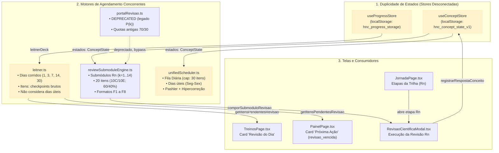

# Auditoria do Motor de Revisões e Estado Atual (Fase U5 — U5.1)
**Plataforma de Estudos "Heuller na Câmara" (HNC)**  
**Cargo:** Analista Legislativo — Documentação e Informação Legislativa (Cargo 5)  
**Banca:** Cebraspe | **Edital:** nº 1, de 02/10/2026 | **Data da Prova:** 17/01/2027  
**Data da Auditoria:** 16 de outubro de 2026  

---

## 1. Visão Geral dos Motores Existentes

A plataforma HNC possui atualmente quatro componentes no domínio de revisão e repetição espaçada, criados em diferentes etapas da evolução do projeto:

| Arquivo | Função Declarada | Origem / Marco | Estrutura de Dados | Store Vinculada |
| :--- | :--- | :--- | :--- | :--- |
| `src/domain/leitner.ts` | Algoritmo clássico de Caixas de Leitner (1 a 5) com intervalos de 1, 3, 7, 14 e 30 dias corridos. | Legado (Marco 1) | `LeitnerItem` (chave: `id` do item) | `useProgressStore.leitnerDeck` |
| `src/domain/portalRevisao.ts` | Motor de seleção para Portais de Revisão `P(k)` com quotas de 10 C e 10 E. | Legado (Marco 2) — Marcado `@deprecated` no Marco R4 | `ItemCandidatoPortal` | `useProgressStore` |
| `src/domain/reviewSubmoduleEngine.ts` | Motor de composição dos Submódulos de Revisão Científica `Rn` (20 itens: 10 C / 10 E; 60% módulo atual e 40% precedentes; teto de 20% para F1 e formatos F2..F8). | Marco R4 / Fase 7 | `ItemRevisaoSubmodulo`, `ComposicaoRevisaoSubmodulo` | `useConceptStore.estados` |
| `src/domain/scheduler/unifiedScheduler.ts` | Agendador unificado inteligente para a "Revisão do Dia". Opera em **dias úteis** (`somarDiasUteis`), com ajuste para dia útil (`ajustarParaDiaUtil`), bônus para conteúdos de alta densidade técnica, aceleração de Pashler, penalidade de hipercorreção (+1500 pts) e intercalação de submódulos. | Marco R5 / Fase 7 | `ConceptState`, `ItemFilaRevisao`, `FilaRevisaoDiaria` | `useConceptStore.estados` |

---

## 2. Diagrama de Relacionamento e Sobreposições Atuais

---

## 3. Principais Sobreposições e Inconsistências Diagnosticadas

### 3.1. Duplicidade de "Decks" e Estado Mental do Aluno
- **Deck A (`useProgressStore.leitnerDeck`):** Armazena itens baseados nos checkpoints originais de submódulos com cálculo simples em **dias corridos** (ex.: se cair no domingo, vence no domingo). É consultado pela `TreinosPage` para exibir o contador `"X itens hoje"` e pelo `PainelPage`.
- **Deck B (`useConceptStore.estados`):** Armazena os ~225 conceitos atômicos derivados com enriquecimento cognitivo, cálculo estrito em **dias úteis** (segunda a sexta), aceleração de Pashler, peso de hipercorreção e formatos cognitivos (F1..F8). É consultado pelo `reviewSubmoduleEngine` e pelo modal `RevisaoCientificaModal`.
- **Efeito:** Uma resposta dada dentro de um submódulo `Rn` atualiza o `useConceptStore`, mas **não atualizava** o `leitnerDeck` do `useProgressStore`. Isso gerava a sensação de que o item continuava "pendente" na tela de Treinos mesmo após ser revisado com sucesso.

### 3.2. Calendário em Dias Corridos vs. Dias Úteis
- O edital Cebraspe tem data estrita (**17/01/2027**). O estudo de reta final precisa respeitar a rotina do candidato.
- `leitner.ts` agenda revisões em dias corridos (`somarDiasDataIso`), fazendo com que revisões caiam no sábado ou domingo.
- `unifiedScheduler.ts` implementa o padrão correto de **dias úteis** (`somarDiasUteis` e `ajustarParaDiaUtil`), garantindo que fins de semana sejam preservados para descanso ou simulados completos (100Q/120Q), evitando acúmulo artificial de atrasos na segunda-feira.

### 3.3. Risco de Dupla Aparição no Mesmo Dia (Revisão do Dia vs. Rn)
- Quando o candidato executa o submódulo de revisão `Rn` ao concluir o Módulo `k`, ele revisa 20 conceitos (12 do módulo atual e 8 dos módulos anteriores).
- Se a "Revisão do Dia" selecionar de forma cega os mesmos conceitos que estão previstos para o `Rn` daquele dia, o candidato sofre redundância e fadiga cognitiva, violando o princípio do espaçamento ideal (*Cepeda et al., 2008*).

### 3.4. Rótulos Conflitantes de Módulos (Problema D12)
- Textos na interface alternam entre `"10 cadernos da trilha (M1 a M10)"`, `"14 módulos do acervo"`, `"59 etapas"` e `"64 submódulos"`.
- A Trilha Principal cobre os 10 módulos de Conhecimentos Específicos (M1 a M10), enquanto o Acervo Completo integra 14 módulos (M1 a M14, incluindo Língua Portuguesa, Raciocínio Lógico, Noções de Direito e Tecnologia/Dados). Essa distinção precisa ser clarificada e padronizada em todos os painéis.

---

## 4. Arquitetura Alvo Unificada (Plano de Ação U5.2 a U5.6)

1. **Fonte Única da Verdade (U5.2):**
   - Unificar o estado de retenção no `useConceptStore` / `unifiedScheduler`. O `useProgressStore` sincroniza ou consome a mesma fonte determinística de conceitos (`ConceptState`).
   - Eliminar a divergência entre `leitnerDeck` e `estados`: quando um item é revisado em `Rn`, seu estado é consolidado na fonte única e deduzido da fila diária.
2. **Encaixe Suave na Trilha (U5.3):**
   - Cada `Rn` é recomendado ao final do Módulo `k` como atividade prioritária, sem bloquear a progressão (modo livre respeitado). O estado `disponivel` permanece acessível a qualquer momento.
3. **Calendário com Reta Final até 17/01/2027 (U5.4):**
   - Intervalos calibrados para a janela de ~90 dias: expansão gradual em dias úteis e **rodada cumulativa intensiva nas 3 semanas anteriores à prova** (a partir de 28/12/2026), respeitando o teto de 30 itens/dia.
4. **Intercalação e Pares Confundíveis (U5.5):**
   - Garantir que cada sessão de `Rn` misture ≥ 3 submódulos distintos e dê prioridade aos pares conceituais de alta confusão mútua catalogados em `src/config/reviewConfig.ts`.
5. **Correção dos Rótulos D12 (U5.6):**
   - Padronizar a nomenclatura: **"Trilha Específica (M1 a M10)"** vs. **"Acervo Complementar (M11 a M14)"**.
